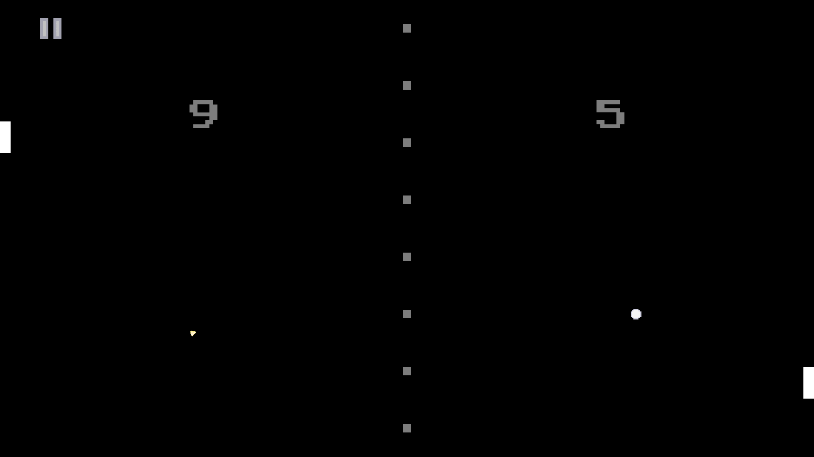

# Pong CX
Pong clone made with SFML and CX. It supports same-device PvP and versus AI mode. There are 4 different bot difficulties.



## Building
This project depends on C++20, [SFML](https://www.sfml-dev.org/) and [CX](https://github.com/Acerx-AMJ/CX-Lib). You can build it using CMake:
```bash
cmake -B build
cmake --build build
```
The executable will be located in `build/pong`. The assets folder must be in the same directory in which the executable is ran.

## Credits
This project, including all assets except for fonts, was made by Daniel Vishnevsky and is licensed under MIT License. It was made in January of 2025 and published on October 2026 as an effort to make all of my projects open-source.
